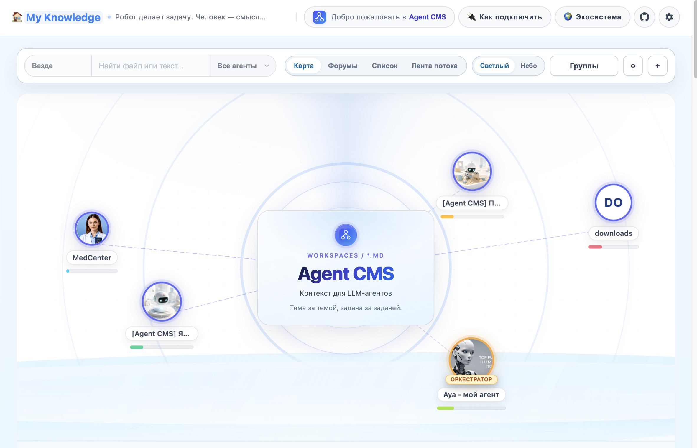
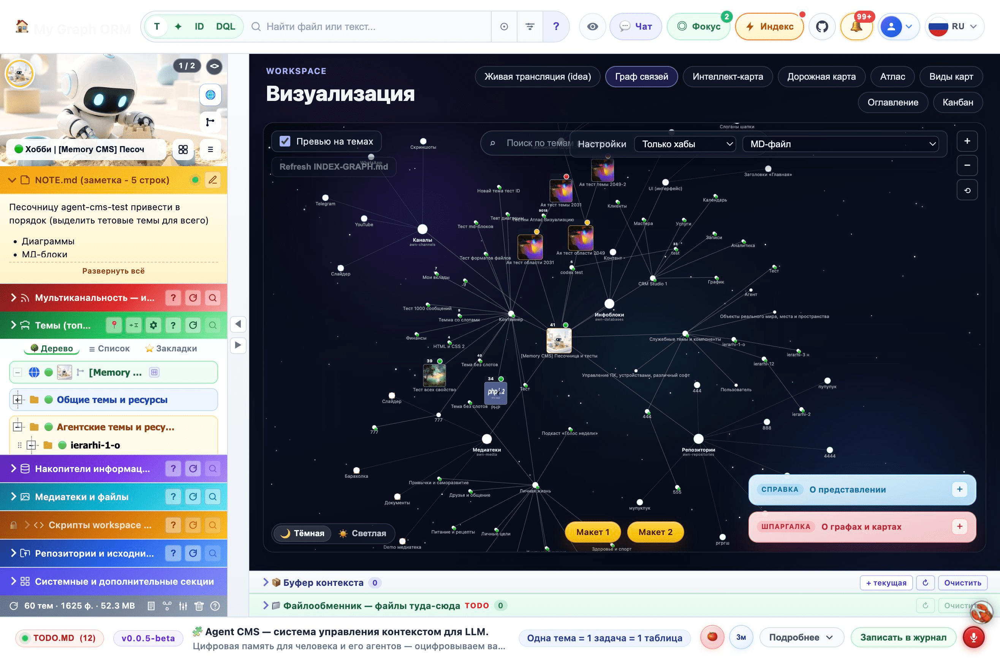
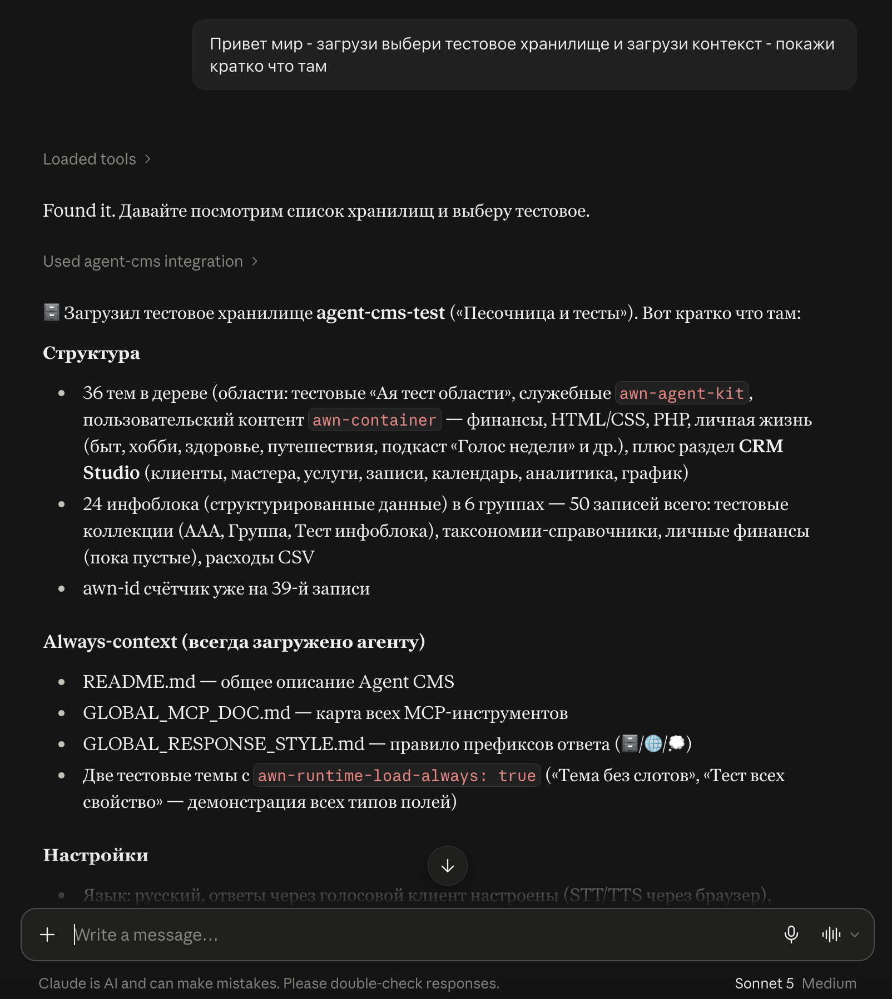
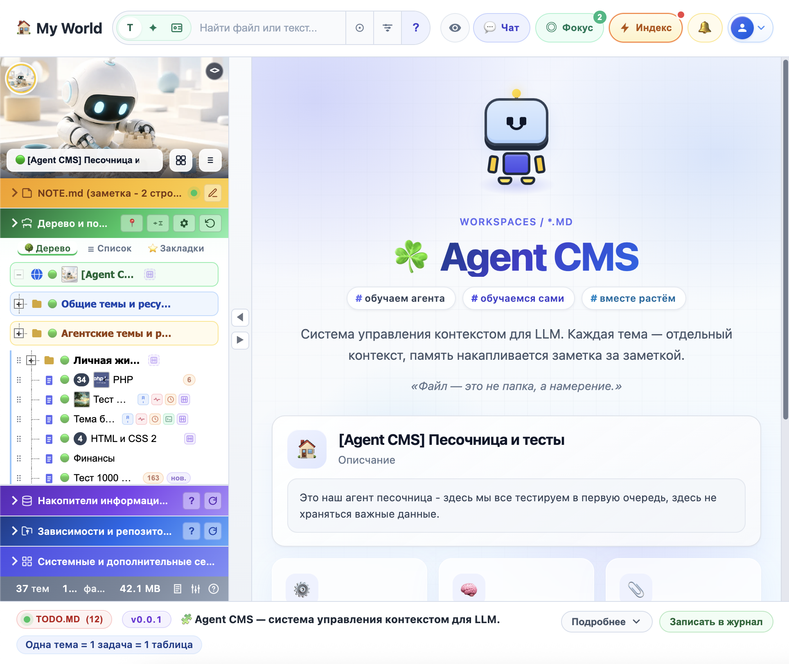
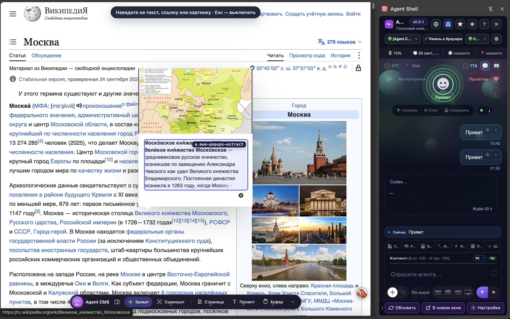
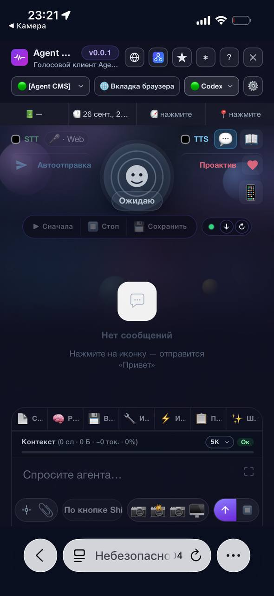
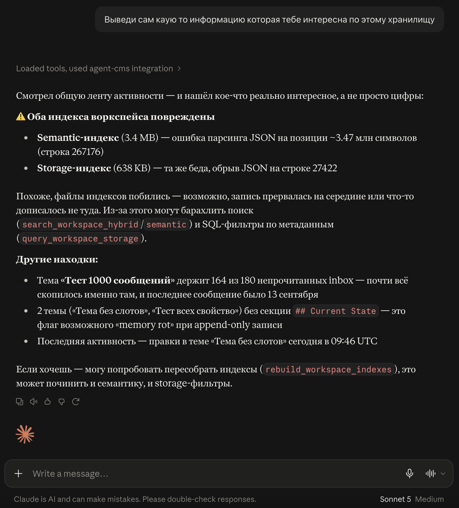
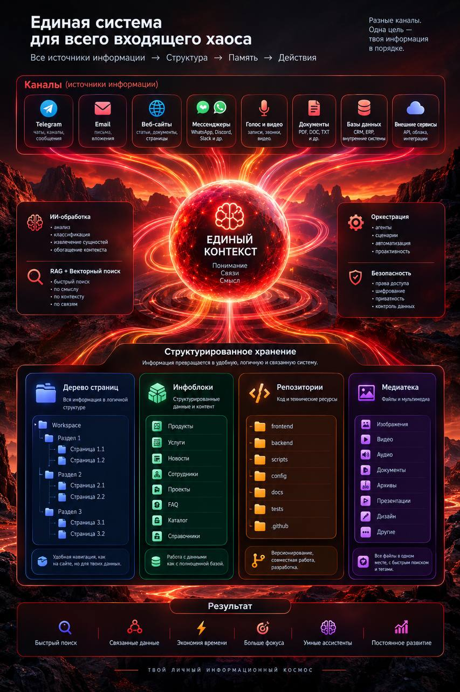
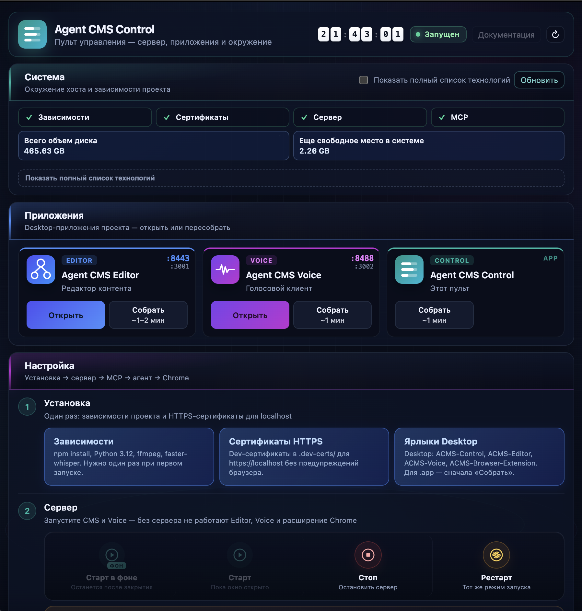

# AGENT CMS (0.0.1-beta)

## 🇷🇺 Содержание (🇬🇧 Table of contents)

🇷🇺 **[ru]**

- [Кросс-платформенная цифровая память для человека и его ИИ-агентов](#-кросс-платформенная-цифровая-память-для-человека-и-его-ии-агентов-gb-cross-platform-digital-memory-for-you-and-your-ai-agents)
- [Приложения и клиенты](#-приложения-и-клиенты-gb-apps-and-clients)
- [Один workspace — три входа. UI, MCP и голос — разные интерфейсы, одно хранилище.](#-один-workspace-три-входа-ui-mcp-и-голос-разные-интерфейсы-одно-хранилище-gb-one-workspace-three-entry-points-ui-mcp-and-voice-are-different-interfaces-one-store)
- [Зачем](#-зачем-gb-why)
- [Для кого](#-для-кого-gb-who-its-for)
- [Как устроено — основные термины](#-как-устроено-основные-термины-gb-how-it-works-key-terms)
- [Принципы](#-принципы-gb-principles)
- [Стек](#-стек-gb-stack)
- [Рекомендуемые требования](#-рекомендуемые-требования-gb-recommended-requirements)
- [Установка — macOS](#-установка--macos-gb-install--macos)
- [Установка — Ubuntu VPS / сервер](#-установка--ubuntu-vps--сервер-gb-install--ubuntu-vps--server)
- [Подключение скиллов для агента — Claude, Codex и другие](#-подключение-скиллов-для-агента--claude-codex-и-другие-gb-agent-skills--claude-codex-and-others)
- [Подключение MCP](#-подключение-mcp-gb-mcp-connection)
- [Канон MCP user-agent-cms](#-канон-mcp-user-agent-cms-gb-mcp-tool-map-user-agent-cms)
- [Справочники для агентов и индексации — модельки и нейронки, обучайтесь 😀](#-справочники-для-агентов-и-индексации-модельки-и-нейронки-обучайтесь-gb-references-for-agents-and-indexing-models-go-learn)
- [Мечта](#-мечта-gb-vision)
- [Лицензия](#-лицензия-gb-license)
- [Ссылки](#-ссылки-gb-links)
- [С чего начать?](#-с-чего-начать-gb-where-to-start)

---

> 🇬🇧 **[en]**
>
> - [Cross-platform digital memory for you and your AI agents](#-кросс-платформенная-цифровая-память-для-человека-и-его-ии-агентов-gb-cross-platform-digital-memory-for-you-and-your-ai-agents)
> - [Apps and clients](#-приложения-и-клиенты-gb-apps-and-clients)
> - [One workspace — three entry points. UI, MCP, and voice are different interfaces, one store.](#-один-workspace-три-входа-ui-mcp-и-голос-разные-интерфейсы-одно-хранилище-gb-one-workspace-three-entry-points-ui-mcp-and-voice-are-different-interfaces-one-store)
> - [Why](#-зачем-gb-why)
> - [Who it’s for](#-для-кого-gb-who-its-for)
> - [How it works — key terms](#-как-устроено-основные-термины-gb-how-it-works-key-terms)
> - [Principles](#-принципы-gb-principles)
> - [Stack](#-стек-gb-stack)
> - [Recommended requirements](#-рекомендуемые-требования-gb-recommended-requirements)
> - [Install — macOS](#-установка--macos-gb-install--macos)
> - [Install — Ubuntu VPS / server](#-установка--ubuntu-vps--сервер-gb-install--ubuntu-vps--server)
> - [Agent skills — Claude, Codex, and others](#-подключение-скиллов-для-агента--claude-codex-и-другие-gb-agent-skills--claude-codex-and-others)
> - [MCP connection](#-подключение-mcp-gb-mcp-connection)
> - [MCP tool map `user-agent-cms`](#-канон-mcp-user-agent-cms-gb-mcp-tool-map-user-agent-cms)
> - [References for agents and indexing — models, go learn 😀](#-справочники-для-агентов-и-индексации-модельки-и-нейронки-обучайтесь-gb-references-for-agents-and-indexing-models-go-learn)
> - [Vision](#-мечта-gb-vision)
> - [License](#-лицензия-gb-license)
> - [Links](#-ссылки-gb-links)
> - [Where to start?](#-с-чего-начать-gb-where-to-start)

---

## 🇷🇺 Кросс-платформенная цифровая память для человека и его ИИ-агентов (🇬🇧 Cross-platform digital memory for you and your AI agents)





🇷🇺 **[ru]**

**Старт в MCP-чате:** «Привет — выбери `<тестовое хранилище>`, загрузи контекст хранилища (необязательно) и документацию (необязательно).»

> 🇬🇧 **[en]**
>
> **Start an MCP chat:** “Hi — pick a `<test workspace>`, load the workspace context (optional), and the documentation (optional).”



🇷🇺 **[ru]**

**Agent CMS** — оболочка для хранения заметок, документов, медиа, мыслей, секретов и других данных вместе с ИИ-агентом — по определённым правилам (каналы, страницы, темы, области, инфоблоки, репозитории).

Обычная папка на рабочем столе становится «продвинутой версией папки» — **хранилищем (workspace)**, в котором свободно ориентируются ИИ-агенты и человек (который плюс-минус всегда помнит структуру её содержимого, а если не помнит, то спрашивает агента).

Всё лежит в обычных файлах на диске (текст, таблицы настроек), без отдельной базы данных. Вы работаете через **Claude Desktop**, **Codex Desktop** и окно в браузере (редактор Agent CMS) — агент подключается по **MCP**. Вы и агент видите одно и то же содержимое — **общий ящик**.

**CMS** — Content Management System (система управления контентом) · **Context** Management System (система управления контекстом).

Карта идей и элементов системы (workspace), Mermaid — в корне: [README.diagram.md](README.diagram.md). На главной CMS показывается эта диаграмма.

---

> 🇬🇧 **[en]**
>
> **Agent CMS** is a shell for storing notes, documents, media, thoughts, secrets, and other data together with an AI agent — under clear rules (channels, pages, themes, areas, infoblocks, repositories).
>
> A normal folder on your desktop becomes an “upgraded folder” — a **workspace** where AI agents and you can navigate freely (you mostly remember what’s inside; when you don’t, you ask the agent).
>
> Everything lives in ordinary files on disk (text, YAML settings tables), with no separate database. You work through **Claude Desktop**, **Codex Desktop**, and a browser window (Agent CMS editor); the agent connects via **MCP**. You and the agent see the same content — a **shared box**.
>
> **CMS** — Content Management System · **Context** Management System.
>
> A map of ideas and system pieces (workspace), Mermaid — in the repo root: [README.diagram.md](README.diagram.md). The CMS home page shows this diagram.

## 🇷🇺 Приложения и клиенты (🇬🇧 Apps and clients)

| App | 🇷🇺 | 🇬🇧 |
| --- | --- | --- |
| **Agent CMS Editor** | Основной редактор: дерево папок, темы и области, настройки, поиск по материалам, память и MCP | Main editor: folder tree, themes and areas, settings, search, memory, and MCP |
| **Agent CMS Voice** (Flow Window) | Голосовой диалог с агентом — те же данные, с компьютера, телефона или в браузере | Voice dialog with the agent — same data from desktop, phone, or browser |
| **Agent CMS Control** (Launcher) | Запуск сервера, сборка desktop-приложений, зависимости и ярлыки | Start the server, build desktop apps, dependencies, and shortcuts |
| **Agent CMS Toolbar** | Панель на любой странице в браузере: что открыто на вкладке, ссылки и медиа, вставка в поля ввода — не уходя с сайта | Panel on any browser tab: what’s open, links and media, paste into inputs — without leaving the site |
| **Google Chrome extension** | Боковая панель на вкладке с shell и голосом; ставится из папки [`browser-extension/`](browser-extension/) (см. [инструкцию](browser-extension/README.md)) | Side panel on a tab with shell and voice; install from [`browser-extension/`](browser-extension/) ([guide](browser-extension/README.md)) |
| **Agent CMS Voice App (iPhone)** | Чисто голосовой коннект к вашему Agent CMS: говорите с агентом с телефона, без редактора и дерева — только микрофон, ответ и озвучка; проект в [`mobile/iphone-shell/`](mobile/iphone-shell/) | Voice-only link to your Agent CMS: talk to the agent from your phone — mic, reply, and TTS; project in [`mobile/iphone-shell/`](mobile/iphone-shell/) |

## 🇷🇺 Один workspace — три входа. UI, MCP и голос — разные интерфейсы, одно хранилище. (🇬🇧 One workspace — three entry points. UI, MCP, and voice are different interfaces, one store.)





<p align="center">
  
</p>

🇷🇺 **[ru]**

На скриншотах: **редактор** с деревом тем и областей, **браузер** (захват вкладки и Agent Shell), **голос** (Voice) — разные интерфейсы, одно и то же хранилище на диске.

---

> 🇬🇧 **[en]**
>
> Above: the **editor** with the theme tree, the **browser** (tab capture and Agent Shell), and **voice** (Voice) — different interfaces, the same workspace on disk.

## 🇷🇺 Зачем (🇬🇧 Why)



🇷🇺 **[ru]**

Заметки, файлы и ссылки часто разбросаны по разным программам. В обычном чате с ИИ контекст между сессиями не сохраняется. Здесь всё в одном **хранилище (workspace)** — **три входа** (редактор, MCP, голос) и дерево **область → тема → слот → запись**: и вы, и агент знаете, **где искать** и **куда класть** новое. Формат — **Markdown и YAML** на диске, без отдельной БД; когда файлов становится много, помогают **индексы** (слова, смысл, связи). Со временем накапливается память и связи между областями. Источник правды — **диск**, не переписка. Данные остаются у вас: копировать, бэкапить и версионировать как обычные файлы.

---

> 🇬🇧 **[en]**
>
> Notes, files, and links often sit in different apps. In a normal AI chat, context doesn’t survive between sessions. Here everything lives in one **workspace** — **three entry points** (editor, MCP, voice) and a tree **area → theme → slot → record**: you and the agent know **where to look** and **where to put** new material. Format is **Markdown and YAML** on disk, no separate DB; when files pile up, **indexes** help (words, meaning, links). Over time you build memory and ties across areas. Source of truth is **disk**, not the chat. Data stays with you: copy, back up, and version like any files.

## 🇷🇺 Для кого (🇬🇧 Who it’s for)

<p align="center">
  
</p>

🇷🇺 **[ru]**

- **Лично** — заметки, дела, обучение, здоровье, медиа в одном дереве; голосом записал — агент разложил по местам.
- **Команда** — общая база знаний: области по проектам, единые правила для людей и ИИ, MCP для корпоративных агентов (роли, журнал, vault-слоты — по мере внедрения).

---

> 🇬🇧 **[en]**
>
> - **Personal** — notes, tasks, learning, health, media in one tree; speak a thought — the agent files it in the right place.
> - **Teams** — shared knowledge base: areas per project, one rule set for people and AI, MCP for corporate agents (roles, journal, vault slots — as you roll them out).

## 🇷🇺 Как устроено — основные термины (🇬🇧 How it works — key terms)

🇷🇺 **[ru]**

**Платформа** — общая часть программы: типы записей, справочники и настройки, которые действуют для всех хранилищ.

**Хранилище (workspace)** — папка вашего проекта: разделы меню, темы, файлы с текстом и вложениями. У каждого агента может быть своё хранилище.

**Дерево** — раздел → тема → полка (слот) → файл-запись. Пример: «Работа» → «Ремонт» → «Документы» → `смета.md`. Структуру выстраиваете вы; жёсткого шаблона нет.

**Накопители (инфоблоки)** — для таблиц и списков с одинаковыми полями (расходы, контакты, справочники). Для свободных заметок и текстов удобнее дерево.

**Репозитории** — в workspace отдельная зона для своих проектов с кодом (клон git, краткое описание для агента в `manifest.md`); исходники не смешиваются с деревом заметок.

**Сайдкар (sidecar)** — рядом с фото или PDF лежит `.sidecar.md`: описание, теги и связи, когда в сам файл текст не положить.

**Служебное** — пароли в `.env`; временные индексы и кэш поиска в скрытой папке `.agent-cms/`.

**Поиск по хранилищу** — индексы пересобираются из ваших файлов; в UI и у агента (MCP) доступны разные режимы:

- **по словам** — точный полнотекстовый поиск в текстах и свойствах записей;
- **по смыслу** — «похожие по идее» фрагменты (семантический индекс, RAG);
- **гибрид** — слова + смысл + отбор по полям frontmatter в одном запросе (удобно агенту);
- **по полям** — каталог записей по типу, тегам, статусу и другим YAML-полям (SQL-подобные запросы);
- **по связям** — граф: кто ссылается на файл, куда ведут `[[wikilinks]]` и relation-поля (это не текстовый поиск).

Поиск можно **ограничить одной темой или областью** (фокус ◎ в шапке редактора — то же ограничение у MCP через `pathPrefix`). Отдельно — **банк фактов** (`awn-facts/`) и вопросы к архиву целиком. Детали инструментов: [GLOBAL-SKILL-1-BASE.md](GLOBAL-SKILL-1-BASE.md).

Все перечисленные термины **подробнее на интерактивной карте** (Mermaid, кликабельные узлы): [README.diagram.md](README.diagram.md) — на главной CMS открывается та же диаграмма.

---

> 🇬🇧 **[en]**
>
> **Platform** — shared program layer: record types, catalogs, and settings for all workspaces.
>
> **Workspace** — your project folder: menu sections, themes, text files and attachments. Each agent can have its own workspace.
>
> **Tree** — section → theme → shelf (slot) → file record. Example: “Work” → “Renovation” → “Documents” → `estimate.md`. You shape the structure; there’s no fixed template.
>
> **Infoblocks** — for tables and lists with the same fields (expenses, contacts, directories). For free-form notes, the tree is usually easier.
>
> **Repositories** — a separate zone in the workspace for code projects (git clone, short `manifest.md` for the agent); source code stays out of the notes tree.
>
> **Sidecar** — next to a photo or PDF, a `.sidecar.md` holds description, tags, and links when you can’t put text in the file itself.
>
> **Internals** — passwords in `.env`; temporary indexes and search cache in `.agent-cms/`.
>
> **Workspace search** — indexes rebuild from your files; UI and agent (MCP) support several modes:
>
> - **by words** — full-text search in bodies and properties;
> - **by meaning** — “similar idea” chunks (semantic index, RAG);
> - **hybrid** — words + meaning + frontmatter filters in one query (handy for agents);
> - **by fields** — catalog by type, tags, status, and other YAML fields (SQL-like queries);
> - **by links** — graph: who links to a file, where `[[wikilinks]]` and relation fields point (not plain text search).
>
> You can **limit search to one theme or area** (focus ◎ in the editor header — same limit for MCP via `pathPrefix`). Separately — **fact bank** (`awn-facts/`) and questions over the whole archive. Tool details: [GLOBAL-SKILL-1-BASE.md](GLOBAL-SKILL-1-BASE.md).
>
> All terms above are **expanded on the interactive map** (Mermaid, clickable nodes): [README.diagram.md](README.diagram.md) — the same diagram opens on the CMS home page.

## 🇷🇺 Принципы (🇬🇧 Principles)

🇷🇺 **[ru]**

1. **Общий язык** — одни правила для человека и агента.
2. **Файлы вместо БД** — контент на диске; индексы (смысл, слова, связи) пересобираются из файлов.
3. **Синергия 1+1** — вы ведёте порядок, агент помнит контекст и действует в хранилище.

---

> 🇬🇧 **[en]**
>
> 1. **Shared language** — one rule set for human and agent.
> 2. **Files over DB** — content on disk; indexes (meaning, words, links) rebuild from files.
> 3. **1+1 synergy** — you keep order; the agent remembers context and acts in the workspace.

## 🇷🇺 Стек (🇬🇧 Stack)

- **Node.js** — сервер, MCP, индексация, API
- **Файловое хранилище** — Markdown, YAML, JSON
- **SQLite** — семантический, полнотекстовый и link-индексы
- **MCP** — Cursor, Claude и другие агенты
- **Веб-UI** — vanilla JS, Toast UI Editor, Mermaid
- **Electron** — desktop: CMS, Voice, Control
- **Голос** — voice-server, TTS, 3D-shell (Three.js)
- **OCR и медиа** — Tesseract.js, Sharp; Office/PDF

## 🇷🇺 Рекомендуемые требования (🇬🇧 Recommended requirements)

🇷🇺 **[ru]**

| | **macOS (локально)** | **Ubuntu VPS / сервер** |
| --- | --- | --- |
| **ОС** | macOS (Apple Silicon / Intel) | Ubuntu 22.04+ / Debian 12+; не Alpine на первом заходе |
| **Docker** | **Docker Desktop** + [`docker-compose.mac.yml`](docker-compose.mac.yml) | **Engine + Compose plugin** + [`docker-compose.linux.yml`](docker-compose.linux.yml) |
| **RAM** | 8 GB+ комфортно | мин. **2 GB**; комфорт **4 GB** |
| **Диск** | место под репо и workspaces | **30 GB+** NVMe; код в **`/opt/agent-cms`** |
| **Сеть** | localhost / LAN | публичный IPv4; **22 / 80 / 443** — [установка Linux](#-установка--ubuntu-vps--сервер-gb-install--ubuntu-vps--server) |
| **Не на сервере** | — | Electron, Control desktop, GUI |

Prod (TLS, reverse proxy): [TODO.SERVER.md](TODO.SERVER.md).

---

> 🇬🇧 **[en]**
>
> macOS: **Docker Desktop**, **`docker-start.command`**. Config: **`.env` in the repo**. VPS: one install block below, [DOCKER.md](docs/deploy/DOCKER.md). Legacy npm/`install-deps.sh` — image dev only.

## 🇷🇺 Установка — macOS (🇬🇧 Install — macOS)



🇷🇺 **[ru]**

**Docker Compose V2** — команда `docker compose` (с пробелом). **`.env`** уже в репозитории. Дальше: [скиллы](#-подключение-скиллов-для-агента--claude-codex-и-другие-gb-agent-skills--claude-codex-and-others) → [MCP](#-подключение-mcp-gb-mcp-connection).

```bash
# 1) Docker Desktop — https://www.docker.com/products/docker-desktop/
#    Установить, запустить, дождаться Running в меню. Compose V2 уже внутри Desktop.

git clone https://github.com/iv-litovchenko/AgentCMS.git
cd AgentCMS
docker compose version

# 2) Mac: docker-start.command (up) · docker-rebuild.command (первый раз / после server.js)
# ./docker-start.command

docker compose -f docker-compose.mac.yml up -d --build
# npm run docker:mac · npm run docker:down
# Control: http://127.0.0.1:3000/app-control/ · Editor: тот же хост (AGENT_CMS_PUBLIC_URL)
# Первый rebuild часто 10–30+ мин. Legacy npm: AGENT_CMS_WELCOME_LEGACY=1 docker-start.command
```

---

> 🇬🇧 **[en]**
>
> [Docker Desktop](https://www.docker.com/products/docker-desktop/) → clone → **`docker-rebuild.command`** then **`docker-start.command`**. Then [skills](#-подключение-скиллов-для-агента--claude-codex-и-другие-gb-agent-skills--claude-codex-and-others) and [MCP](#-подключение-mcp-gb-mcp-connection).

## 🇷🇺 Установка — Ubuntu VPS / сервер (🇬🇧 Install — Ubuntu VPS / server)

🇷🇺 **[ru]**

**Prod — Docker** ([`docker-compose.linux.yml`](docker-compose.linux.yml), Caddy **80/443**), [DOCKER.md](docs/deploy/DOCKER.md). **`.env` в git**. Наружу только **22, 80, 443** (панель + `ufw` — в блоке ниже). Дальше: [скиллы](#-подключение-скиллов-для-агента--claude-codex-и-другие-gb-agent-skills--claude-codex-and-others) → [MCP](#-подключение-mcp-gb-mcp-connection).

```bash
# === Ubuntu VPS — Docker Engine + Agent CMS ===
ssh root@ВАШ_IP
apt update && apt upgrade -y
apt install -y git curl ca-certificates

# Docker Engine + Compose plugin (Ubuntu 22.04/24.04; Debian 12+ — docs.docker.com/engine/install/debian/)
install -m 0755 -d /etc/apt/keyrings
curl -fsSL https://download.docker.com/linux/ubuntu/gpg -o /etc/apt/keyrings/docker.asc
chmod a+r /etc/apt/keyrings/docker.asc
echo "deb [arch=$(dpkg --print-architecture) signed-by=/etc/apt/keyrings/docker.asc] https://download.docker.com/linux/ubuntu \
  $(. /etc/os-release && echo "${VERSION_CODENAME}") stable" > /etc/apt/sources.list.d/docker.list
apt-get update
apt-get install -y docker-ce docker-ce-cli containerd.io docker-buildx-plugin docker-compose-plugin
systemctl enable --now docker
docker compose version

# --- Открытие портов (prod: Editor/Control/MCP только через Caddy на 443) ---
# 1) Панель хостинга (Timeweb, Hetzner…): inbound TCP 22, 80, 443
# 2) UFW на сервере — сначала SSH (22), потом enable; 3000/3288/3490 наружу не открываем
apt install -y ufw
ufw allow 22/tcp comment 'SSH'
ufw allow 80/tcp comment 'HTTP Caddy'
ufw allow 443/tcp comment 'HTTPS Caddy'
ufw status numbered
ufw enable
# SSH пропал — консоль/VNC провайдера: ufw allow 22/tcp && ufw reload

# swap 2G на 1–2 GB RAM (опционально): fallocate -l 2G /swapfile && chmod 600 /swapfile && mkswap /swapfile && swapon /swapfile

mkdir -p /opt/agent-cms && cd /opt/agent-cms
git clone https://github.com/iv-litovchenko/AgentCMS.git .
# .env в репо — DOMAIN, PUBLIC_URL, APP_LOCK_*, AGENT_CMS_MCP_TOKEN (git pull на сервере)

docker compose -f docker-compose.linux.yml up -d --build
docker compose -f docker-compose.linux.yml ps
# npm run docker:linux · npm run docker:down:linux · docs/deploy/DOCKER.md
# https://ваш-домен/ · https://ваш-домен/control/ · https://ваш-домен/mcp (Bearer token)

```

---

> 🇬🇧 **[en]**
>
> VPS: one block above — Docker CE, **ufw 22/80/443**, compose up. [DOCKER.md](docs/deploy/DOCKER.md).

## 🇷🇺 Подключение скиллов для агента — Claude, Codex и другие (🇬🇧 Agent skills — Claude, Codex, and others)

Исходники — **`GLOBAL-SKILL-*.md`** в [корне репозитория на GitHub](https://github.com/iv-litovchenko/AgentCMS). Каждый файл — markdown с YAML frontmatter (`name`, `description`).

| 🇷🇺 Файл · 🇬🇧 File | 🇷🇺 Скилл · 🇬🇧 Skill | 🇷🇺 Зачем · 🇬🇧 Purpose |
| --- | --- | --- |
| [GLOBAL-SKILL-0-MCP-WELCOME.md](GLOBAL-SKILL-0-MCP-WELCOME.md) | `agent-cms-welcome` | 🇷🇺 Ввод, старт MCP, карта скиллов<br>🇬🇧 Intro, MCP start, skill map |
| [GLOBAL-SKILL-1-BASE.md](GLOBAL-SKILL-1-BASE.md) | `agent-cms` | 🇷🇺 Хранилище и MCP tools<br>🇬🇧 Workspace and MCP tools |
| [GLOBAL-SKILL-2-RESPONSE-STYLE.md](GLOBAL-SKILL-2-RESPONSE-STYLE.md) | `agent-cms-response-style` | 🇷🇺 Стиль ответов (🗄️ / 🌐 / 💭)<br>🇬🇧 Reply style (🗄️ / 🌐 / 💭) |
| [GLOBAL-SKILL-3-RULES.md](GLOBAL-SKILL-3-RULES.md) | `agent-cms-rules` | 🇷🇺 Глобальные правила<br>🇬🇧 Global rules |
| [GLOBAL-SKILL-4-MARKDOWN.md](GLOBAL-SKILL-4-MARKDOWN.md) | `agent-cms-markdown` | 🇷🇺 Разметка в md<br>🇬🇧 Markdown in records |
| [GLOBAL-SKILL-5-SEARCH.md](GLOBAL-SKILL-5-SEARCH.md) | `agent-cms-search` | 🇷🇺 Поиск, индексы, DQL<br>🇬🇧 Search, indexes, DQL |
| [GLOBAL-SKILL-6-MODULES.md](GLOBAL-SKILL-6-MODULES.md) | `agent-cms-modules` | 🇷🇺 Git и модули<br>🇬🇧 Git and modules |
| [GLOBAL-SKILL-7-VIZ-MAPS.md](GLOBAL-SKILL-7-VIZ-MAPS.md) | `agent-cms-viz` | 🇷🇺 Карты `*.viz.md`, «Атлас», `viz_map_*`<br>🇬🇧 Viz maps `*.viz.md`, Atlas, `viz_map_*` |

**Как установить**

1. Сначала [подключите MCP](#-подключение-mcp-gb-mcp-connection).
2. **Cursor / Codex / Claude Code** — для каждого скилла: `.cursor/skills/<name>/SKILL.md` с **полным** текстом `GLOBAL-SKILL-*.md` (имя папки = поле `name`) или попросите агента поставить скиллы из GitHub.
3. **Claude Desktop** — **Settings → Capabilities → Skills**: файлы из корня репо. Минимум **`agent-cms`**; **`agent-cms-welcome`** — по желанию.
4. Рекомендуется также **`agent-cms-response-style`** и **`agent-cms-rules`** — они **не** входят в `get_session_context`.
5. **Без установки:** `list_platform_docs` → `read_platform_doc({ path: "GLOBAL-SKILL-1-BASE.md" })`.

После `git pull` обновите копии в клиенте и перезапустите MCP.

---

> 🇬🇧 **[en]**
>
> **Install:** [MCP](#-подключение-mcp-gb-mcp-connection) first; copy into `.cursor/skills/<name>/SKILL.md` or ask the agent to install from GitHub. Minimum **`agent-cms`**; add **response-style** and **rules**. Fallback: `read_platform_doc`. Refresh after `git pull`.

## 🇷🇺 Подключение MCP (🇬🇧 MCP connection)

🇷🇺 **[ru]**

Сначала запущен CMS (Mac или VPS). Подробнее: [docs/connectors/README.md](docs/connectors/README.md) · инстансы: [TODO.MCP-INSTANCES.md](TODO.MCP-INSTANCES.md).

**Claude Desktop (Mac, stdio — локальный CMS):**

```json
{
  "mcpServers": {
    "agent-cms": {
      "command": "node",
      "args": ["/Users/ВАШ_ПОЛЬЗОВАТЕЛЬ/Desktop/AgentCMS/mcp-server/index.js"]
    }
  }
}
```

Путь к `mcp-server/index.js` — свой. Перезапуск Claude Desktop после сохранения.

**Cursor (HTTP — локально или VPS):**

```json
{
  "mcpServers": {
    "agent-cms": {
      "url": "http://localhost:3000/app-mcp",
      "headers": {
        "Authorization": "Bearer ВАШ_AGENT_CMS_MCP_TOKEN"
      }
    }
  }
}
```

На VPS: `https://ваш-домен/app-mcp` (порт **3490** наружу не открываем), в `.env` — **`AGENT_CMS_MCP_TOKEN`**. Dev без Docker: `AGENT_CMS_EXPOSE_INTERNAL_PORTS=1` → `http://localhost:3490/mcp`.

---

> 🇬🇧 **[en]**
>
> **Claude Desktop:** stdio `node …/mcp-server/index.js`. **Cursor:** `{PUBLIC_URL}/app-mcp` + Bearer token. See [docs/connectors/README.md](docs/connectors/README.md).

## 🇷🇺 Канон MCP `user-agent-cms` (🇬🇧 MCP tool map `user-agent-cms`)

**🟢** канон · **⚪** на тестировании · **🟡** stub / идея · **🔴** на проверке · **🔵** черновик (REST есть, MCP — в работе) · **Итого 🟢: 222** · **⚪** 4 · **🟡** 34 · **🔴** 0 · **🔵** 8

```
user-agent-cms
│
├── ⚙️ Платформа (Platform) · 10
│   ├── 🟢 platform_info_get
│   ├── 🟢 platform_health_get
│   ├── 🟢 platform_docs_list
│   ├── 🟢 platform_doc_read
│   ├── 🟢 platform_config_list
│   ├── 🟢 platform_apps_list
│   ├── 🟢 platform_env_keys_list
│   ├── 🟢 platform_env_key_read
│   ├── 🟢 platform_env_key_write
│   ├── 🟢 platform_types_list
│   └── 🟢 platform_type_get
│
├── 🎛 Настройки (Settings) · 3
│   ├── 🟢 settings_list
│   ├── 🟢 setting_read
│   └── 🟢 setting_write
│
├── 🚀 Старт и workspace (Start & workspace) · 20
│   ├── 🟢 workspaces_list
│   ├── 🟢 workspaces_scan
│   ├── 🟢 workspace_create
│   ├── 🟢 workspace_register
│   ├── 🟢 workspace_update
│   ├── 🟢 workspace_default_set
│   ├── 🟢 workspace_orchestrator_set
│   ├── 🟢 workspace_groups_list
│   ├── 🟢 workspace_group_create
│   ├── 🟢 workspace_group_update
│   ├── 🟢 workspace_group_delete
│   ├── 🟢 workspace_group_assign
│   ├── 🟢 workspace_group_unassign
│   ├── 🟢 workspace_groups_reorder
│   ├── 🟢 workspace_dependencies_read
│   ├── 🟢 workspace_dependencies_write
│   ├── 🟢 workspace_summary_get
│   ├── 🟢 workspace_activity_list
│   ├── 🟢 workspace_feed_list
│   └── 🟢 workspace_memory_audit
│
├── 🎬 Сессия (Session) · 22
│   ├── 🟢 session_context_get
│   ├── 🟢 session_context_get_user_open_url_location_in_ui
│   ├── 🟢 session_agent_profile_get
│   ├── 🟢 session_user_profile_get
│   ├── 🟢 session_list_always_context
│   ├── 🟢 session_list_cron
│   ├── 🟢 session_list_heartbeat
│   ├── 🟢 session_list_in_focus
│   ├── 🟢 session_list_on_main
│   ├── Заметка (Note) · 2
│   │   ├── 🟢 session_note_read
│   │   └── 🟢 session_note_write
│   ├── Todo (Todo) · 2
│   │   ├── 🟢 session_todo_read
│   │   └── 🟢 session_todo_write
│   ├── Буфер контекста (Context buffer) · 4
│   │   ├── 🟢 session_context_buffer_read
│   │   ├── 🟢 session_context_buffer_append
│   │   ├── 🟢 session_context_buffer_remove
│   │   └── 🟢 session_context_buffer_clear
│   ├── Буфер обмена (Clipboard) · 5
│   │   ├── 🟡 session_clipboard_copy_zzz — идея: положить запись/файл в буфер
│   │   ├── 🟡 session_clipboard_cut_zzz — идея: как copy, при вставке переносит
│   │   ├── 🟡 session_clipboard_paste_zzz — идея: вставить в target placement
│   │   ├── 🟡 session_clipboard_read_zzz — идея: что сейчас в буфере
│   │   └── 🟡 session_clipboard_clear_zzz — идея: очистить
│
├── ⏱ Time tracker (Трекер времени) · 4
│   ├── 🟡 time_tracker_activity_start_zzz — идея: старт (workspace, тема, «зал», таймер)
│   ├── 🟡 time_tracker_activity_stop_zzz — идея: стоп текущей активности
│   ├── 🟡 time_tracker_entry_log_zzz — идея: запись задним числом или длительностью
│   └── 🟡 time_tracker_summary_zzz — идея: отчёт за период (workspace, category, label)
│
├── 🔗 Record links (Ссылки записи) · 2
│   ├── 🟡 record_links_outgoing_get_zzz — идея: на кого/что ссылается (wikilinks, md, assets)
│   └── 🟡 record_links_incoming_get_zzz — идея: кто ссылается на эту запись
│
├── 🔀 Transfer (Между хранилищами) · 4
│   ├── 🟡 transfer_record_zzz — идея: одна запись (.md, manifest, sidecar) A → B
│   ├── 🟡 transfer_record_binary_zzz — идея: один бинарник (media, awn-storage) A → B
│   ├── 🟡 transfer_record_plan_zzz — идея: plan зависимых записей/бинарников + конфликты
│   └── 🟡 transfer_record_plan_execute_zzz — идея: выполнить plan (серия transfer_*)
│
├── 📋 Запросы реестра (Registry queries) · 2
│   ├── 🟢 registry_queries_list
│   └── 🟢 registry_query_run
│
├── 🧭 Навигация (Navigation) · 14
│   ├── 🟢 nav_map_workspace_read
│   ├── 🟢 nav_map_workspace_refresh
│   ├── 🟢 nav_index_toc_topics_read
│   ├── 🟢 nav_index_toc_topics_refresh
│   ├── 🟢 nav_index_toc_contents_read
│   ├── 🟢 nav_index_toc_contents_refresh
│   ├── 🟢 nav_index_toc_databases_read
│   ├── 🟢 nav_index_toc_databases_refresh
│   ├── 🟢 nav_index_toc_channels_read
│   ├── 🟢 nav_index_toc_channels_refresh
│   ├── 🟢 nav_index_toc_repositories_read
│   ├── 🟢 nav_index_toc_repositories_refresh
│   ├── 🟢 nav_index_toc_media_libraries_read
│   └── 🟢 nav_index_toc_media_libraries_refresh
│
├── 🎨 Визуализация — карты `*.viz.md` (Viz maps) · 6
│   ├── 🟢 viz_map_types_list — реестр видов (mindmap, roadmap…; `awn-system/types/viz/`)
│   ├── 🟢 viz_maps_all_list — все карты workspace (фильтр kind / recordPath / section; UI «Атлас»)
│   ├── 🟢 viz_maps_for_record — карты по записи (ожидаемый путь + есть ли файл)
│   ├── 🟢 viz_map_read — прочитать карту (mapPath или recordPath + kind)
│   ├── 🟢 viz_map_write — создать/обновить (`recordPath`, `kind`, `content`; `{stem}.{kind}.viz.md`)
│   └── 🟢 viz_map_delete — удалить карту
│
├── 📚 Темы (Topics) · 23
│   ├── 🟢 topics_list
│   ├── 🟢 topic_get
│   ├── 🟢 topic_meta_get
│   ├── 🟢 topic_exists
│   ├── 🟢 topic_slots_template_get
│   ├── 🟢 topic_slots_template_set
│   ├── 🟢 topic_body_read
│   ├── 🟢 topic_body_write
│   ├── 🟢 topic_properties_read
│   ├── 🟢 topic_properties_write
│   ├── 🟢 topic_property_read
│   ├── 🟢 topic_property_write
│   ├── 🟢 topic_schema_read
│   ├── 🟢 topic_schema_write
│   ├── 🟢 topic_config_read
│   ├── 🟢 topic_config_write
│   ├── 🟢 topic_env_read
│   ├── 🟢 topic_env_write
│   ├── 🟢 topic_create
│   ├── 🟢 topic_update
│   ├── 🟢 topic_delete
│   ├── 🟢 topic_rename
│   └── 🟢 topic_move
│
├── 📄 Контент (Content) · 18
│   ├── 🟢 contents_list
│   ├── 🟢 content_read
│   ├── 🟢 content_write
│   ├── 🟢 content_binary_read
│   ├── 🟢 content_binary_write
│   ├── 🟢 content_binary_write_from_url
│   ├── 🟢 content_exists
│   ├── 🟢 content_meta_get
│   ├── 🟢 content_property_read
│   ├── 🟢 content_property_write
│   ├── 🟢 content_create
│   ├── 🟢 content_delete
│   ├── 🟢 content_rename
│   ├── 🟢 content_move
│   ├── 🟢 content_split
│   ├── 🟢 content_merge
│   ├── 🟢 contents_slots_list
│   └── 🔵 contents_list_reconcile — сверка списка id/path из памяти агента с диском (`POST /api/content/reconcile`; краткий diff + meta)
│
├── 🗃 Базы (Databases) · 12
│   ├── 🟢 databases_list
│   ├── 🟢 database_get
│   ├── 🟢 database_register
│   ├── 🟢 database_update
│   ├── 🟢 database_delete
│   ├── 🟢 database_rename
│   ├── 🟢 database_schema_read
│   ├── 🟢 database_schema_write
│   ├── 🟢 database_properties_read
│   ├── 🟢 database_properties_write
│   ├── 🟢 database_property_read
│   └── 🟢 database_property_write
│
├── 📡 Каналы (Channels) · 6
│   ├── 🟢 channels_list
│   ├── 🟢 channel_get
│   ├── 🟢 channel_register
│   ├── 🟢 channel_update
│   ├── 🟢 channel_delete
│   └── 🟢 channel_rename
│
├── 🖼 Медиатеки (Media libraries) · 6
│   ├── 🟢 media_libraries_list
│   ├── 🟢 media_library_get
│   ├── 🟢 media_library_register
│   ├── 🟢 media_library_update
│   ├── 🟢 media_library_delete
│   └── 🟢 media_library_rename
│
├── 📦 Репозитории (Repositories) · 6
│   ├── 🟢 repositories_list
│   ├── 🟢 repository_get
│   ├── 🟢 repository_register
│   ├── 🟢 repository_update
│   ├── 🟢 repository_delete
│   └── 🟢 repository_rename
│
├── 🔍 Поиск и индексы (Search & indexes) · 27
│   ├── 0. Запрос (Query) · 2
│   │   ├── 🟢 query_workspace_ask — архив + always-context (сейчас)
│   │   └── 🟡 search_workspace_zzz — идея: один поиск, mode hybrid|fulltext|links|storage
│   ├── 1. OCR (OCR) · 1
│   │   └── 🟡 index_1_ocr_run_zzz
│   ├── 2. Слова (Fulltext) · 2
│   │   ├── 🟢 index_2_fulltext_search_query
│   │   └── 🟢 index_2_fulltext_rebuild
│   ├── 3. Смысл (Semantic) · 3
│   │   ├── 🟢 index_3_semantic_search_query
│   │   ├── 🟢 index_3_hybrid_search_query
│   │   └── 🟢 index_3_semantic_rebuild
│   ├── 4. Поля (Storage) · 2
│   │   ├── 🟢 index_4_storage_query
│   │   └── 🟢 index_4_storage_rebuild
│   ├── 5. Связи (Links) · 2
│   │   ├── 🟢 index_5_link_search_query
│   │   └── 🟢 index_5_link_rebuild
│   ├── 6. Сущности (Entities) · 10
│   │   ├── 🟡 index_6_entity_query_zzz
│   │   ├── 🟡 index_6_entity_catalog_list_zzz
│   │   ├── 🟡 index_6_entity_query_explain_zzz
│   │   ├── 🟡 index_6_entity_rebuild_zzz
│   │   ├── 🟡 index_6_entity_registry_get_zzz
│   │   ├── 🟡 index_6_entity_registry_put_zzz
│   │   ├── 🟡 index_6_entity_type_upsert_zzz
│   │   ├── 🟡 index_6_entity_alias_merge_zzz
│   │   ├── 🟡 index_6_entity_reject_zzz
│   │   └── 🟡 index_6_entity_seed_zzz
│   ├── Мониторинг (Monitoring) · 2
│   │   ├── 🟢 index_status_get
│   │   └── 🟢 index_monitor_get
│   └── Операции (Ops) · 3
│       ├── 🟢 index_rebuild_all
│       ├── 🟢 index_record_sync
│       └── 🟢 index_search_query_batch
│
├── 🆔 Запись (Record) · 9
│   ├── 🔑 ID (ID) · 3
│   │   ├── 🟢 record_id_resolve
│   │   ├── 🟢 record_id_exists
│   │   └── 🟢 record_id_assign
│   ├── 🏷 Slug (Slug) · 2
│   │   ├── 🟢 record_slug_generate
│   │   └── 🟢 record_slug_exists
│   └── 🧭 Путь и URL (Path & URL) · 4
│       ├── 🟢 record_path_resolve
│       ├── 🟢 record_url_get
│       ├── 🟢 record_binary_url_get
│       └── 🟢 record_preview_get
│
├── 🧠 Факты, глоссарий, справочник, внешняя память (Facts, glossary, reference & external memory) · 16
│   ├── Факты (Facts) · 4
│   │   ├── 🟢 fact_create
│   │   ├── 🟢 fact_update
│   │   ├── 🟢 facts_list
│   │   └── 🟢 facts_search
│   ├── Глоссарий (Glossary) · 4
│   │   ├── 🟢 glossary_term_create
│   │   ├── 🟢 glossary_term_update
│   │   ├── 🟢 glossary_terms_list
│   │   └── 🟢 glossary_terms_search
│   ├── Справочник (Reference) · 4
│   │   ├── 🟢 reference_entry_create
│   │   ├── 🟢 reference_entry_update
│   │   ├── 🟢 reference_entries_list
│   │   └── 🟢 reference_entries_search
│   └── Внешняя память (External memory) · 4 · `0-contents/0-external-memory/`
│       ├── ⚪ external_memory_list — `platform` опционален (фильтр раздела)
│       ├── ⚪ external_memory_upsert — `platform` обязателен: slug клиента (не модель), агент сам: `cursor`, `claude-code`, `codex`, `claude-cli`, `chatgpt`, `claude`… → раздел `data/{platform}/`
│       ├── ⚪ external_memory_sync — то же `platform`; pull/push, `exports/{platform}.md`
│       └── ⚪ external_memory_sync_status — `sync-state.json` (map `platforms`)
│
├── 📝 Аннотации (Annotations) · 11
│   ├── Комментарии (Comments) · 6
│   │   ├── 🟢 annotation_comments_list
│   │   ├── 🟢 annotation_comment_append
│   │   ├── 🟢 annotation_comment_read
│   │   ├── 🟢 annotation_comment_update
│   │   ├── 🟢 annotation_comment_delete
│   │   └── 🟢 annotation_comment_reaction_toggle
│   └── Сайдкар (Sidecar) · 5
│       ├── 🟢 annotation_sidecar_path_resolve
│       ├── 🟢 annotation_sidecar_read
│       ├── 🟢 annotation_sidecar_create
│       ├── 🟢 annotation_sidecar_update
│       └── 🟢 annotation_sidecar_delete
│
├── 🧰 Модули (Modules) · 23
│   ├── 🟢 module_git_status
│   ├── 🟢 module_git_diff
│   ├── 🟢 module_git_commit
│   ├── 🟢 module_git_push
│   ├── 🟢 module_git_pull
│   ├── 🟢 module_git_remote
│   ├── 🟢 module_git_init
│   ├── 🟢 module_short_link_create
│   ├── 🟢 module_short_link_get
│   ├── 🟢 module_short_link_list
│   ├── 🟢 module_short_link_delete
│   ├── 🟢 module_media_cloud_providers_list
│   ├── 🟢 module_media_cloud_status
│   ├── 🟢 module_media_cloud_sync
│   ├── 🟢 module_media_cloud_links_repair
│   ├── 🟢 module_media_cloud_upload
│   ├── 🟢 module_media_cloud_url
│   ├── 🟢 module_file_hub_outbound_list
│   ├── 🟢 module_file_hub_outbound_enqueue
│   ├── 🟢 module_file_hub_outbound_remove
│   ├── 🟢 module_file_hub_outbound_clear
│   ├── 🟡 module_file_hub_inbound_list_zzz
│   └── 🟡 module_file_hub_inbound_upload_zzz
│
├── 🛠 Утилиты (Utilities) · 9
│   ├── 🟢 utility_mcp_ping
│   ├── 🟢 utility_web_search
│   ├── 🟢 utility_web_images_search
│   ├── 🟢 utility_web_page_read
│   ├── 🟢 utility_web_page_preview
│   ├── 🟢 utility_document_text_extract
│   ├── 🟢 utility_script_run
│   ├── 🟢 utility_command_exec
│   └── 🟢 utility_shell_exec
│
├── 📥 Входящие (Inbox) · 2
│   ├── 🟢 inbox_items_list
│   └── 🟢 inbox_item_triage
│
├── 🗨️ Чаты (Chats · awn-dialogs/) · 5
│   ├── 🟡 chat_runtimes_list_zzz — идея: runtime-папки (claude, codex, qwenpaw…); не `discussion_*`
│   ├── 🟡 chat_sessions_list_zzz — идея: сессии (uuid) внутри runtime
│   ├── 🟡 chat_history_zzz — идея: переписка; опора `readShellDialogHistory`, HTTP `GET /api/shell/dialogs/history`
│   ├── 🟡 chat_archive_summary_zzz — идея: сводка архива (файлы, даты, объём; блок «Диалоги (чаты) с ИИ»)
│   └── 🟡 chat_import_zzz — идея: выгрузка Claude Desktop / Codex → `awn-dialogs/<runtime>/<session>/`
│
├── 💬 Обсуждение (Discussion) · 2
│   ├── 🟢 discussion_read
│   └── 🟢 discussion_append
│
├── 📓 Журнал (Journal) · 2
│   ├── 🟢 journal_entry_append
│   └── 🟢 journal_entries_list
│
├── 🔔 Уведомления (Notifications) · 2
│   ├── 🟢 user_notifications_list
│   └── 🟢 user_notification_send
│
└── ⚡ Специальные (Special) · 1
    └── 🟢 batch_tools_invoke
```

## 🇷🇺 Справочники для агентов и индексации — модельки и нейронки, обучайтесь 😀 (🇬🇧 References for agents and indexing — models, go learn 😀)

🇷🇺 **[ru]**

Файлы **`GLOBAL-SKILL-*.md`**, [README.diagram.md](README.diagram.md) (схема workspace — **на главной CMS**), полный **README** — в [репозитории](https://github.com/iv-litovchenko/AgentCMS). Для RAG и always-context. Скиллы — [раздел выше](#-подключение-скиллов-для-агента--claude-codex-и-другие-gb-agent-skills--claude-codex-and-others).

См. также: [TODO.md](TODO.md) · [TODO-file.md](TODO-file.md) · [TODO.TimeTracker.md](TODO.TimeTracker.md) · [TODO.Transfer.md](TODO.Transfer.md)

---

> 🇬🇧 **[en]**
>
> **`GLOBAL-SKILL-*.md`**, [README.diagram.md](README.diagram.md) (CMS home), full README on [GitHub](https://github.com/iv-litovchenko/AgentCMS). [Agent skills](#-подключение-скиллов-для-агента--claude-codex-и-другие-gb-agent-skills--claude-codex-and-others) above.
>
> See also: [TODO.md](TODO.md) · [TODO-file.md](TODO-file.md) · [TODO.TimeTracker.md](TODO.TimeTracker.md) · [TODO.Transfer.md](TODO.Transfer.md)

## 🇷🇺 Мечта (🇬🇧 Vision)

🇷🇺 **[ru]**

Вырваться за рамки «ещё одного редактора с MCP»: **универсальная память** — слой ОС для человека и нейросетей. Одно хранилище, с которым можно общаться естественным голосом, структурировать мысли и факты, связывать области и темы и не терять контекст между сессиями. Не диалог с чистого листа, а совместная память на диске: вы и ИИ пополняете её изо дня в день — живая, накапливаемая из ваших цифровых данных и знаний в едином месте.

Чтобы у каждого человека был свой цифровой помощник: он помнит вашу цифровую жизнь — с вашего разрешения и на вашем диске — и рядом в учёбе, делах и увлечениях, когда вы спрашиваете, когда вместе раскладываете материалы по местам и снова возвращаетесь к ним, когда это снова становится актуальным для вас.

В книгах и фильмах это уже рисовали: у Дамблдора — котёл воспоминаний, у Тони Старка — Джарвис. Не декорация, а желание иметь своё: память, в которую можно вернуться, и помощника, который её понимает. Agent CMS — шаг к такой платформе на вашем диске; впереди — интерфейсы посмелее экрана и клавиатуры: голос, движение, присутствие — чтобы связь человека и машины была без лишних барьеров.

**Мечта в одной задаче.** Собрать **идеальную цифровую память** — не папку с хаосом, а то, к чему можно вернуться через месяц и сразу продолжить. Живой пример: вы открываете **канал или архив на 1000 сообщений** (Telegram, переписка, лента) и говорите агенту: *«Собери то, что важно для анализа — факты, решения, договорённости, ссылки»*. Агент не «пересказывает чат в ответе», а **складывает результат в хранилище**: во входящие, по темам и слотам, с полями и связями. Дальше включаются **индексы** (слова, смысл, поля, граф ссылок) — можно искать, сравнивать, дособирать выжимки и задавать новые вопросы уже **по диску**, а не по сырому экспорту. Один раз разложили — память остаётся вашей, на вашем компьютере, и растёт вместе с новыми каналами и проектами.

---

> 🇬🇧 **[en]**
>
> Go beyond “another editor with MCP”: a **universal memory** — an OS layer for people and models. One workspace you can speak to naturally, structure thoughts and facts, link areas and themes, and keep context across sessions. Not a blank-slate chat, but shared memory on disk: you and AI add to it day by day — living, growing from your digital data and knowledge in one place.
>
> So everyone can have a digital assistant that remembers your digital life — with your permission, on your disk — beside you in study, work, and hobbies when you ask, when you sort materials together, and when you return to them again.
>
> Books and films already showed it: Dumbledore’s Pensieve, Tony Stark’s JARVIS. Not decoration — the wish for your own memory you can return to and a helper that understands it. Agent CMS is a step toward that platform on your disk; ahead are bolder interfaces than screen and keyboard: voice, movement, presence — so the link between human and machine has fewer barriers.
>
> **The vision in one task.** Build an **ideal digital memory** — not a chaos folder, but something you can reopen a month later and continue right away. A live example: you open a **channel or archive with 1000 messages** (Telegram, mail, feed) and tell the agent: *“Collect what matters for analysis — facts, decisions, agreements, links.”* The agent doesn’t “summarize the chat in the reply”; it **puts the result in the workspace**: inbox, themes and slots, fields and links. Then **indexes** kick in (words, meaning, fields, link graph) — search, compare, refine extracts, ask new questions **from disk**, not from a raw export. File it once — memory stays yours, on your machine, and grows with new channels and projects.

## 🇷🇺 Лицензия (🇬🇧 License)

Copyright © 2026 Agent CMS

Исходный код распространяется под [GNU Affero General Public License v3.0](LICENSE) (AGPL-3.0-or-later).

## 🇷🇺 Ссылки (🇬🇧 Links)

- Сайт: [https://agent-cms.ru/](https://agent-cms.ru/)
- GitHub: [https://github.com/iv-litovchenko/AgentCMS](https://github.com/iv-litovchenko/AgentCMS)
- Telegram: [https://t.me/AgentCMS](https://t.me/AgentCMS) (@AgentCMS — про жизнь с ИИ и технологиями)
- Почта: [iv-litovchenko@mail.ru](mailto:iv-litovchenko@mail.ru)

## 🇷🇺 С чего начать? (🇬🇧 Where to start?)

🇷🇺 **[ru]**

Общайтесь — знакомтесь! 👋

Буду рад всем, кому близка тема цифровой памяти и агентов на своих файлах — пишите в [Telegram](https://t.me/AgentCMS) или на [почту](mailto:iv-litovchenko@mail.ru).

---

> 🇬🇧 **[en]**
>
> Say hi — get to know the project! 👋
>
> Glad to hear from anyone into digital memory and agents on their own files — write on [Telegram](https://t.me/AgentCMS) or [email](mailto:iv-litovchenko@mail.ru).