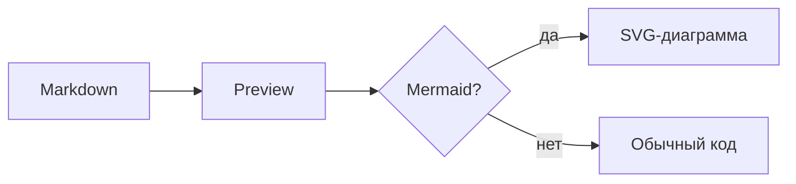

# GLOBAL-SKILL-4-MARKDOWN — поддерживаемая markdown-разметка

Справочник элементов для preview (markdown-it). Кнопка **MD** в шапке редактора открывает этот файл. В always-context агентов попадает опционально (`always-context-global-markdown-showcase`, по умолчанию выкл).

---

## Базовое

# H1 · ## H2 · ### H3 · #### H4 · ##### H5 · ###### H6

Абзац с **жирным**, *курсивом*, ***жирным курсивом***, `inline code`. `breaks: true` — перенос строки в исходнике даёт `<br>`.

| Что | Синтаксис | Preview |
|-----|-----------|---------|
| Жирный / курсив / оба | `**т**` / `*т*` / `***т***` | да |
| Inline-код | `` `код` `` | да |
| Зачёркнутый | `~~т~~` | нет (нужен плагин; в WYSIWYG сохраняется как `~~…~~`) |

[Ссылка](https://example.com) · автоссылка https://github.com/markdown-it/markdown-it

- Маркированный список
  - Вложенный
1. Нумерованный
   1. Вложенный

> Цитата
>
> > Вложенная

Горизонтальная линия — `---`. HTML включён (`html: true`): `<div style="color:red">Красный</div>`.

```javascript
console.log("блок кода с подсветкой");
```

---

## Выделение маркером (`==…==`)

Правило Agent CMS: фон для inline-текста. Работает в Preview, WYSIWYG и при экспорте.

| Синтаксис | Цвет |
|-----------|------|
| `==текст==` | жёлтый (по умолчанию) |
| `=={red}текст==` | красный |
| `=={green}текст==` | зелёный |
| `=={blue}текст==` | синий |
| `=={gray}текст==` | серый |
| `=={orange}текст==` | оранжевый |
| `=={purple}текст==` | фиолетовый |

==жёлтый== · =={red}красный== · =={green}зелёный== · =={blue}синий== · =={gray}серый== · =={orange}оранжевый== · =={purple}фиолетовый==

HTML-эквивалент: `<mark class="md-highlight md-highlight--blue">текст</mark>`; обычный `<mark>` — жёлтый.

---

## Изображения


Вставка из редактора сохраняет файл в `awn-storage/assets/pasted/` и даёт ссылку:

```markdown

```

Preview подставляет URL `/api/media/file?…`.

### Оформление (обёртка `<div class="img-style-…">` вокруг ``)

| Класс | Поведение |
|-------|-----------|
| `img-style-card` | `max-width: min(50%, 520px)`, `max-height: 360px`, `object-fit: contain` |
| `img-style-clamp` | `max-width: clamp(180px, 45vw, 520px)` — **используется в обзоре темы** |
| `img-style-figure` | `<figure>` + `<figcaption>` — подписи «Вложение 1, 2, 3…» |
| `img-style-grid` | сетка, `object-fit: cover` — несколько скринов подряд |
| `img-style-lightbox` | миниатюра (`max-height: 280px`), клик — оверлей |
| `img-style-overview` / `img-style-editor` | компактный обзор / полная ширина в редакторе |
| `img-style-auto` | по `naturalWidth/naturalHeight`: > 1.4 — `is-wide` (70%), иначе `is-compact` (240px) |

Пример (`clamp`):

<div class="img-style-clamp">


</div>

Пример (`figure`):

<div class="img-style-figure">
<figure><figcaption>Вложение 1 · подпись</figcaption></figure>
</div>

---

## GitHub Alerts

Blockquote + `[!TYPE]` (регистр не важен): `NOTE`, `TIP`, `IMPORTANT`, `WARNING`, `CAUTION`.

> [!NOTE]
> Информация, которую стоит учесть.

> [!TIP]
> Необязательная подсказка.

> [!IMPORTANT]
> Ключевая информация.

> [!WARNING]
> Критичный контент, риск.

> [!CAUTION]
> Негативные последствия действия.

Свой заголовок:

> [!WARNING] Внимание
> Заменяет стандартный заголовок.

---

## Диаграммы (Mermaid)

Блоки `mermaid` рендерятся в Preview, overview и навигации (в WYSIWYG блок остаётся текстом).



Поддерживаются и другие типы Mermaid: `sequenceDiagram`, `gantt` и т. д.

---

## Чеклист

Плагин `markdown-it-task-lists` (Preview и WYSIWYG).

- [ ] Не сделано
- [x] Сделано
- [X] Тоже сделано (регистр X не важен)

---

## Wikilinks (Obsidian-style)

Ссылка на другую ноду workspace, если путь найден; иначе класс `wikilink--unresolved`.

[[Другая нода]] · [[Путь/К ноде|Подпись]] · [[Страница#Заголовок]]

---

## Маркеры и пометки (`awn-marker-*`)

Многострочные личные пометки — **блок кода** с языком `awn-marker-<type>`. В Preview CMS и обзоре темы — цветные карточки; в WYSIWYG, Cursor и Obsidian — обычный fenced block. Вставка из палитры: «Маркеры и пометки».

````markdown
```awn-marker-idea
awn-status: отложено
awn-create: 2026-09-27
приоритет: низкий
---
Текст пометки — абзацы, списки, **выделение**.
```
````

- Строки до `---` — мета `ключ: значение`; `---` — разделитель; дальше — тело (markdown).
- **`<type>`** (порядок в палитре): `idea` идея · `important` важно · `note` заметка · `todo` задача · `question` вопрос · `mistake` ошибка · `term` термин · `repeat` повторить.
- **Канонические мета-поля** (необязательные): `awn-create` (дата появления), `awn-update` (последнее изменение), `awn-status` (`открыто`, `закрыто`, `отложено`…), `awn-repeat` (когда пересмотреть).
- **Синонимы:** `добавлено`, `обновлено`, `статус`, `повторить`.
- **Произвольные поля** (`приоритет`, `источник`, `тег`…) — в preview чипы со значением; не валидируются.

Ещё пример:

````markdown
```awn-marker-question
awn-status: открыто
awn-repeat: 2026-10-15
---
Как отличить `awn-marker-term` от обычной цитаты?
```
````

---

## Таблицы (GFM)

| Колонка A | Колонка B |
|-----------|-----------|
| alpha     | beta      |

---

## Для разработчика

Правила markdown-it — в `public/main.js`, `getMarkdownIt()`: `md_highlight` (`==…==`), `wikilink` (`[[…]]`), `markdownItTaskLists`, `markdownItGitHubAlerts`. Новое inline-правило: `md.inline.ruler.before("link", "my_rule", …)` + `md.renderer.rules.my_rule`.

---

*Конец showcase. Канон: `GLOBAL-SKILL-4-MARKDOWN.md`.*
