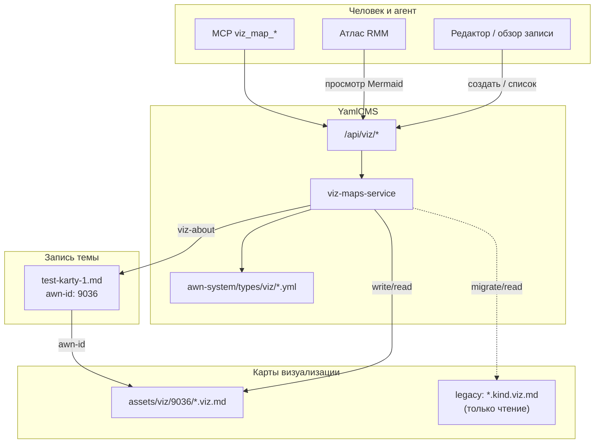

Пример карты **architecture** для записи «Тест карты 1»: как устроен слой `*.viz.md` в Agent CMS (канон `assets/viz/{awn-id}/`).

| Узел | Роль |
|------|------|
| **viz-about** | Полный путь записи-«хозяина» карты |
| **viz-kind** | Вид из реестра (здесь `architecture`) |
| **Атлас** | Список всех `*.viz.md` workspace + превью диаграммы |
